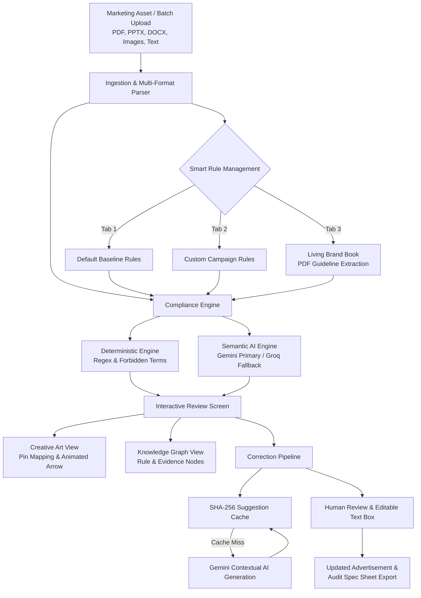

# Before It Goes Live

> **Automated Pre-Flight Marketing Governance & Legal Compliance Release Gate**  
> Visual-first, AI-powered brand compliance. Catch regulatory violations, verify factual claims, and apply context-aware surgical fixes on real marketing designs before anything gets published.

[](https://before-it-goes-live.vercel.app/)
[](https://dashboard.render.com)
[](#)

---

## Overview

### The Problem
Marketing and growth teams publish collateral rapidly across digital and print channels—social ads, product packaging, brochures, and sales pitch decks. Before launch, every asset must satisfy strict legal and brand requirements:
- **FDA & Healthcare Regulations**: Prohibits unapproved medical, therapeutic, and absolute disease claims on cosmetic, wellness, and dietary products.
- **FTC Green Guides**: Prohibits unqualified environmental and sustainability claims (e.g., *"100% natural"*, *"zero-carbon"*, *"chemical-free"*) without third-party laboratory verification.
- **FTC Endorsement & Clinical Guides**: Mandates documented study protocol citations, sample sizes, and statistically valid survey data before making claims like *"Dermatologist Recommended"* or *"Clinically Proven"*.
- **Company Brand & Tone Standards**: Strict rules around logo usage, approved product descriptions, offer conditions, and prohibited competitor comparisons.

Manual legal review takes days, while unvetted publishing risks costly regulatory fines, mandatory public retractions, and irreversible brand damage.

### The Solution: Before It Goes Live
Most compliance tools are clunky forms that spit out walls of legal jargon. Marketing doesn't live in plain text—it lives in visual creatives, multi-page slide decks, and banner graphics. **Before It Goes Live** treats compliance like a visual design review:
- **Visual Pin Mapping**: Numbered, color-coded risk markers are pinned directly onto the creative artwork where violations occur.
- **Live Animated Connector**: Clicking any finding draws an animated SVG curve connecting the visual pin directly to its explanation card.
- **Smart Rule Management System**: Gating across structured default baseline rules, custom brand policies, and an AI-driven Living Brand Book.
- **Context-Aware AI Suggestions**: Generates compliant, natural replacement copy taking surrounding copy into account, with an editable preview and instant SHA-256 caching.
- **Dual Perspective**: Seamless toggle between the visual Creative Art View and an interactive node-and-edge Knowledge Graph.

---

## Key Features & Capabilities

### 1. Smart Rule Management System
A source-grounded policy gating interface organized into three distinct, dedicated modes:
- **Default Rules**: A structured, battle-tested baseline of company policies (medical/clinical claims, FTC Green Guides, pricing disclaimers, trademark usage, and competitor comparisons). Includes one-click *"Use Default Rules"* and quick configuration toggles.
- **Custom Rules**: Author and customize campaign-specific policies, exact prohibited terms, mandatory required wording, severity levels, and channel/audience scopes (Global, Social, Packaging, Email, etc.).
- **Living Brand Book**: Upload existing company brand guidelines and policy PDFs. The system extracts actionable rules with exact quotations and source citations (`source_filename`, `source_page`). Extracted rules remain candidates until a reviewer explicitly approves and activates them.

### 2. Multi-Tier Compliance Engine (Deterministic + Semantic AI)
- **Deterministic Pattern Verification**: Instant, deterministic matching of prohibited phrases, forbidden terms, and quoted mandatory disclosures.
- **Semantic AI Understanding**: Centralized integration with Google Gemini (primary) and Groq (fallback) to detect nuanced semantic issues—unsubstantiated claims, missing qualification disclaimers, or tone contradictions.
- **Reliable Risk Scoring**: Strictly distinguishes clean, compliant audits from incomplete extraction or provider timeouts. Never fabricates a *"Low Risk"* score from failed analysis.

### 3. Visual Creative Canvas & Dynamic Pin Mapping
- Supports single and multi-page assets (PNG, JPG, PDF, PPTX, DOCX, TXT, MD, CSV).
- Color-coded risk badges: **High Risk** (red), **Medium Risk** (amber), and **Low Risk** (blue).
- Pins reflect actual issue locations from OCR and document parsing—never arbitrary or fabricated coordinates.
- **Dynamic Multi-Page Reader**: Splits multi-page PDFs into clickable page tabs (`P.1`, `P.2`...) with full-screen theater mode.

### 4. Interactive Review & Animated Connectors
- **Animated SVG Connector Arrow**: Visually connects the flagged pin on your artwork directly to the active finding card.
- **Dual Review Modes**:
  - *Creative Art View*: Visual layout review for designers and marketers.
  - *Knowledge Graph View*: Interactive node-and-edge visual graph connecting claims to governing regulations (FDA, FTC) and evidentiary standards.

### 5. Context-Aware AI Suggestions & In-App Human Approval
- **One-Click "Apply AI Suggestion"**: Analyzes the flagged phrase, surrounding copy, and active brand rules to generate a surgical, context-appropriate replacement.
- **Human-in-the-Loop Editable Preview**: The proposed replacement loads into an editable text box. Reviewers can modify the wording or approve it directly.
- **Instant Document & Specification Update**: Confirming a replacement updates the document in real time and renders the revised copy in the *Updated Advertisement and Revised Specifications* panel.
- **High-Performance SHA-256 Caching**: Validated suggestions are cached in SQLite (`correction_suggestion_cache`) keyed by `(organization_id, flagged_text, surrounding_copy, rules_snapshot)`. Identical or recurring flaggings resolve in milliseconds without duplicate AI API calls.

### 6. Campaign Batch Queue
- Select up to 20 files (or ZIP archives) per batch.
- Automatically prioritizes assets by risk severity (High $\rightarrow$ Medium $\rightarrow$ Low).
- Track clearance progress (e.g., *"3 of 12 Cleared"*) with a *"Next in Queue"* shortcut.

### 7. Production-Ready Export & Audit Ledger
- Download structured compliance audit specification sheets (`.txt`) detailing all resolved and remaining items.
- One-click copy for finalized, approved marketing copy ready for production release.

---

## System Architecture



---

## Intake Specifications and Limits

| Parameter | Limit |
| :--- | :--- |
| **Max File Size** | 20 MiB per single asset |
| **Max Batch Size** | 50 MiB total per batch (up to 20 files or ZIP archive) |
| **Max Text Extraction** | 100,000 characters per document |
| **Max PDF Length** | 100 pages per PDF document |
| **Supported File Types** | `.pdf`, `.pptx`, `.docx`, `.txt`, `.md`, `.csv`, `.png`, `.jpg`, `.jpeg`, `.webp`, `.zip` |

---

## Tech Stack

- **Frontend**: React 19, TypeScript, Vite, Tailwind CSS, Lucide Icons
- **Backend**: Python 3.11+, FastAPI, Uvicorn, Python-Multipart, SQLite
- **AI Engine**: Centralized Google Gemini (`gemini-2.5-flash` / `gemini-3.1-flash-lite`) primary with Groq (`qwen/qwen3.8-27b`) fallback
- **Design System**: Dark glassmorphic interface with reactive SVG connectors
- **Deployment**: Vercel (Frontend SPA) + Render (FastAPI Web Service)

---

## Project Structure

```text
Before-It-Goes-Live/
├── backend/
│   ├── uploads/                   # Staged upload files
│   ├── before_it_goes_live.db     # SQLite persistence & cache
│   ├── database.py                # Database models, schemas & seed rules
│   ├── engine.py                  # Regulatory rule matching & claim extraction
│   ├── main.py                    # FastAPI application & review endpoints
│   ├── ai_provider.py             # Resilient Gemini & Groq fallback provider
│   ├── requirements.txt           # Python dependencies
│   └── test_*.py                  # Test suites (API, validation, auth)
│
├── frontend/
│   ├── src/
│   │   ├── components/            # GraphView, ConfigureRules, IssueCard, Navigation
│   │   ├── pages/
│   │   │   ├── Home.tsx           # Multi-format drag-and-drop intake & batch queue
│   │   │   ├── RuleSetup.tsx      # Smart 3-Tab Rule Management System
│   │   │   ├── Review.tsx         # Creative Art View, Pin Mapping, AI Suggestions
│   │   │   ├── Activity.tsx       # Historical audit logs & resolved decisions
│   │   │   └── Account.tsx        # Multi-tenant workspace settings
│   │   ├── api.ts                 # Type-safe backend client
│   │   ├── App.tsx                # Routing and session management
│   │   └── main.tsx               # Entry point
│   ├── package.json
│   └── vite.config.ts
│
└── README.md
```

---

## Live Deployment

- **Frontend**: [before-it-goes-live.vercel.app](https://before-it-goes-live.vercel.app/)
- **Backend API**: Hosted on Render with persistent disk storage for SQLite database and multi-tenant audit logs.

---

## License & Usage

Proprietary — Developed for internal marketing governance, legal compliance pre-flight checks, and brand safety.
